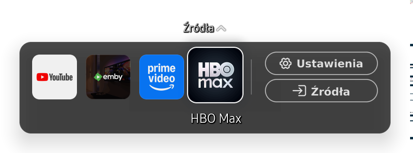

# Vetro Q64T Graphite

A compact Home bar, editable pinned apps and persistent TV customizations for a Samsung QE65Q64TAUXXH running Tizen 5.5.

The Home bar is centered near the bottom of the screen, uses a black background at 70% opacity and stays resident while hidden. It opens over the current app, keeps Settings and Sources at the end, labels the focused item and hides after five seconds of inactivity.

## Tested device

| Item | Verified value |
| --- | --- |
| Model | Samsung QE65Q64TAUXXH |
| Firmware | T-NKLDEUC-2743.0 |
| Tizen | 5.5 |
| TV service runtime | Node.js 4.4.3 |
| Native dock | EFL through the TV's signed .NET launcher |
| Root entry used | Remote PC / CIFS credential substitution |
| Persistence | Device-specific boot hook; verified across full kernel restarts |

Compatibility is established for this device and firmware. Resource hashes and the persistence preparation deliberately reject unexpected originals. The generic Tizen root project was investigated, but it was not the root entry used for this installation.

## Features

- **Home panel** in Vetro: preview the row, select installed and enabled apps, replace a tile, drag to reorder, use accessible arrow buttons, add or unpin apps, and save to the TV.
- Immediate tile reload without restarting the dock process, remote bridge or foreground video app. The saved layout survives a full restart.
- Graphite / Samsung appearance switch. Native resources are overlaid with bind mounts and restored when switching back.
- Native Home requests are intercepted before its window is mapped, eliminating the original bar flashing when returning from Settings.
- Native settings retain Picture, Sound and General. Apps is available under General; About this TV is the final entry.
- Remote mappings: Netflix → Emby, Rakuten TV → YouTube, Ambient blocked, microphone hold and release → keyboard search.
- Persistent HbbTV and MultiScreen blocks, six optional background service blocks, and explicit app launch blocks with state visible in Vetro.
- English Vetro interface, including custom controls, errors, theme status and remote summaries.

Native TV labels in the screenshots follow the TV's configured language. Application titles come from its installed app catalog.

## Start here

Read the [complete start-to-finish walkthrough](docs/START-TO-FINISH.md), including certificate setup, root, failed approaches, retained changes and final verification.

1. Read [compatibility and preparation](docs/INSTALL.md).
2. For a TV without root, follow [the root entry procedure](docs/ROOT.md).
3. Build the helpers and prepare the theme from your own TV's originals.
4. Set up the remote and [edit the Home panel](docs/HOME-PANEL.md).
5. Prepare and check persistence before explicitly applying the boot hook.
6. Follow [verification](docs/VERIFICATION.md) and keep the [rollback procedure](docs/ROLLBACK.md) available offline.

An existing installation can be updated using `tools/update.py`; the updater was exercised on the tested TV. It retains theme files and pinned-app layout. First-install generators and root preparation enforce the recorded compatibility checks, but have not been repeated on a second device.

## Startup result

| Measured milestone | Before | After |
| --- | ---: | ---: |
| Remote bridge authenticated with the complete mapping set | 36.89 s | 20.04 s |
| Dock process created | 12.272 s | 10.640 s |

The dock was ready before the remote authentication milestone. Times are relative to kernel startup and come from one controlled full restart for each configuration. Removing the second remote-bridge launch and moving background verification out of interface startup reduced the mapping milestone by 16.85 seconds. These are cold-boot measurements, not standby wake times or guarantees for other TVs. A later Home-panel persistence test authenticated the remote at 13.78 s and first observed complete Home readiness at 28.11 s; startup milestones vary between runs.

The animation factor remains 0.2. Testing the animation setting alone did not establish a noticeable responsiveness improvement.

## Screenshots and preview

See [the screenshot index](docs/SCREENSHOTS.md). Native TV captures are actual compositor client buffers, without a photograph or video frame behind them. A separate offline dashboard export is included for inspecting the English interface; it is not presented as a photograph of the TV or a live connection.

## Source layout

| Directory | Contents |
| --- | --- |
| `app/` | Vetro port, dashboard, root command adapter and managed helper binaries/sources |
| `dock/src/` | Native Home bar, layout, navigation and in-process app reload |
| `theme/` | Overlay scripts, original-resource compatibility hashes and original graphite bitmap assets |
| `root/` | Boot hook, guarded persistence writer, service block helpers and disposable Remote PC lab |
| `tools/` | Explicit-target API client, build, update and first-install preparation |
| `tests/` | Backend and dashboard checks |
| `evidence/` | Validation summary without device identifiers or credentials |

Samsung firmware binaries, native system assemblies, theme archives, rootfs blocks, certificates, private tokens and account data are not included. Theme and renderer candidates are generated from the owner's TV.

## Upstream projects and licensing

- [Vetro](https://github.com/andrearicci93/vetro), baseline revision `fb1cadc66ff52cd86358b751e17c1cfb225e0733`.
- [tiz0wn](https://github.com/sebastianspicker/tiz0wn), Remote PC / CIFS research and disposable lab; baseline revision `8dd475a9028f2290f4c409945877be99d74d630b`.
- [samsung-tv-root](https://github.com/chris-ritsen/samsung-tv-root), alternative root research reviewed during compatibility investigation.
- [glass-home-samsung-tv](https://github.com/victaphu/glass-home-samsung-tv), visual reference for the compact Home concept.

MIT-licensed source notices are retained in [LICENSE](LICENSE) and [licenses](licenses/). Phosphor assets retain their separate notice. Application logos and Samsung UI captures identify the software shown and are not relicensed as project artwork. See [NOTICE.md](NOTICE.md).
