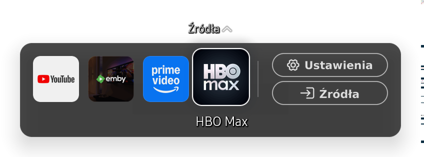
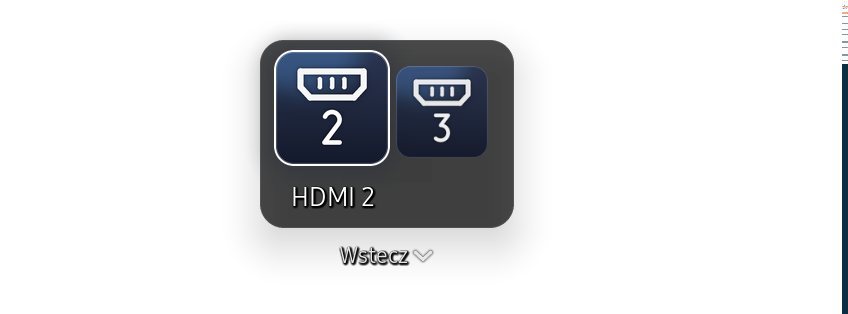

# Screenshots

## Native Home

Actual compositor client buffer from the Q64T. It shows the app row, focused label, Settings and Sources. The TV uses Polish native labels. Transparent areas are preserved; no movie or television broadcast is used as a backdrop. The compositor's buffer includes a narrow stride-padding edge outside the logical window.

## Connected sources

Actual compositor buffer of the Sources page. Connected ports are shown with native icons; focus reveals the corresponding label. A recognized device name appears when that port is selected, otherwise the port number is used.

## Vetro dashboard

`dashboard-preview/` contains an offline HTML export of the English dashboard, redacted data and the application icons required for the preview. It does not connect to or control the TV. Dashboard page screenshots have not been included in this snapshot; the native screenshots above are not a substitute labeled as dashboard captures.

Run `python3 tools/preview.py` from the repository root and open `http://127.0.0.1:8768` to inspect its API-backed controls. Home saves affect the in-memory preview only. The main application in `app/service/dashboard.js` and its Home panel are the deployed, live-tested version.
